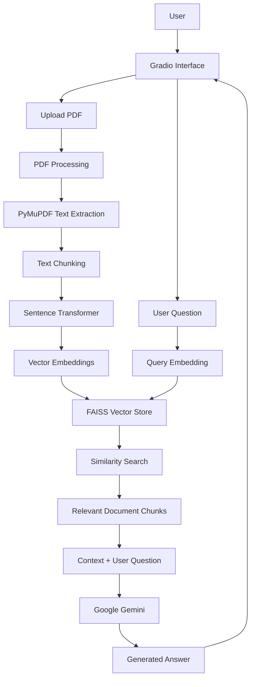
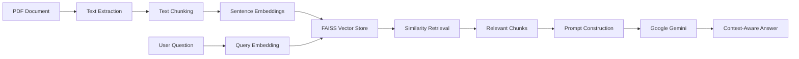
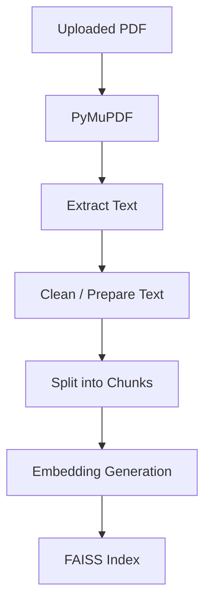
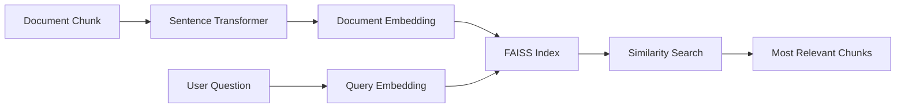
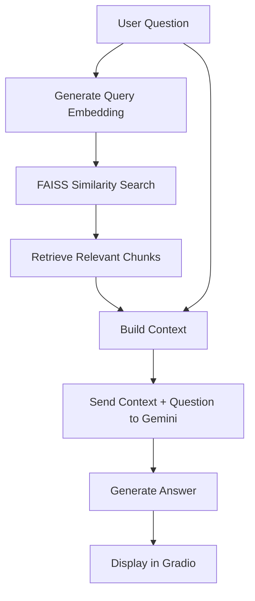
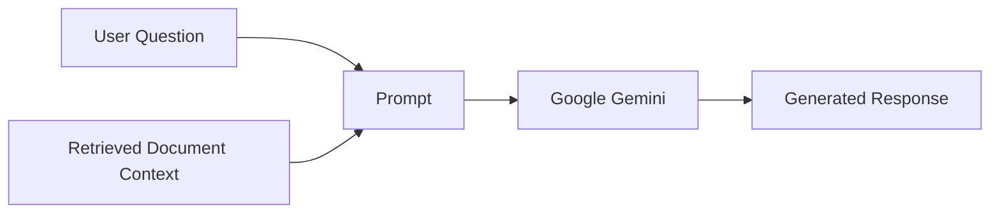
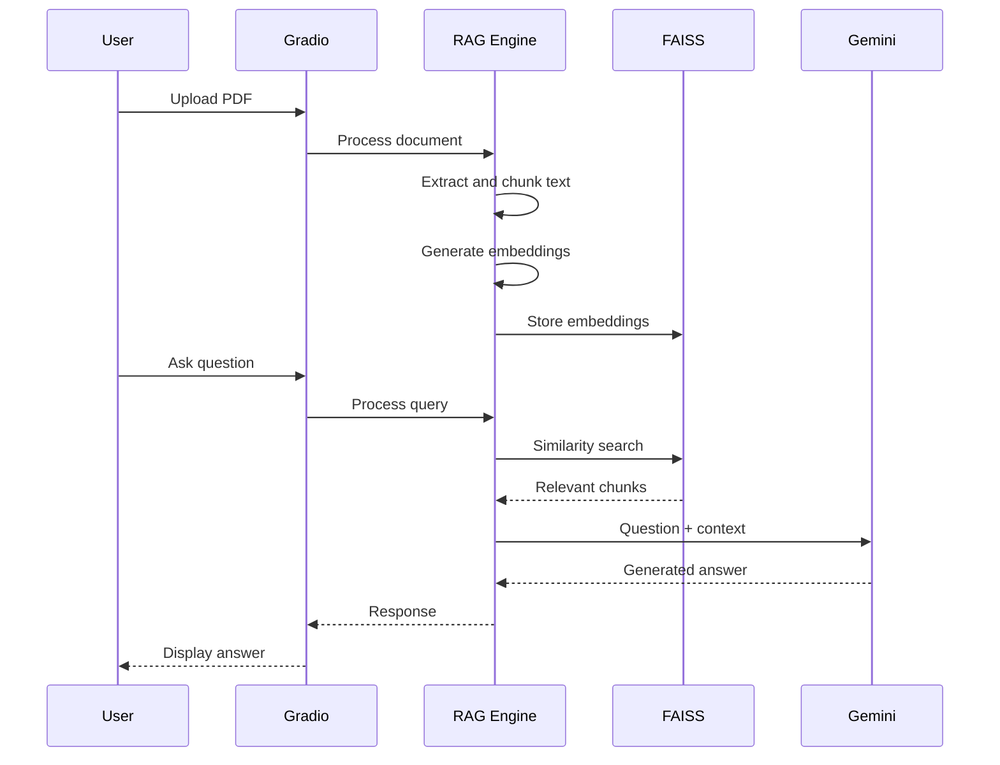
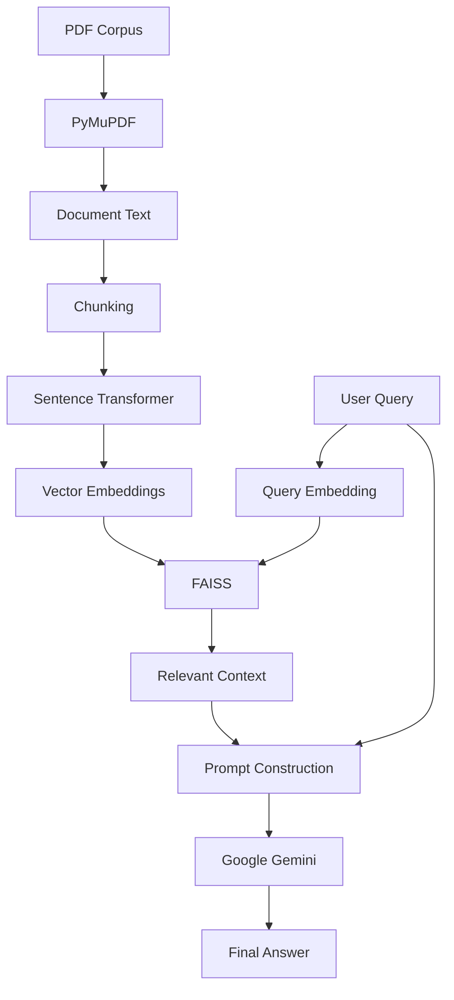

# 🤖 RAG AI Assistant

A document-based **Retrieval-Augmented Generation (RAG)** assistant that allows users to upload PDF documents and ask questions about their content through a conversational interface.

The system combines **PDF text extraction, semantic embeddings, FAISS similarity search, and Google Gemini** to retrieve relevant document context before generating an answer.

---

## 🎯 Project Objective

Large language models can answer general questions, but they do not automatically have access to the contents of a user's private documents.

This project addresses that problem by building a RAG pipeline that:

1. Accepts a PDF document.
2. Extracts its text.
3. Splits the text into manageable chunks.
4. Converts chunks into vector embeddings.
5. Stores embeddings in a FAISS vector index.
6. Retrieves relevant chunks for a user's question.
7. Sends the retrieved context to Google Gemini.
8. Generates a context-aware response.

The goal is to make document-based question answering more useful by **grounding responses in the uploaded document**.

---

# ✨ Features

* 📄 PDF document upload
* 📝 Automatic PDF text extraction
* ✂️ Text chunking
* 🧠 Sentence Transformer embeddings
* 🔎 FAISS semantic similarity search
* 📚 Retrieval-Augmented Generation
* 🤖 Google Gemini-powered responses
* 💬 Conversational Gradio interface
* 🗑️ Clear chat functionality
* 📊 Document processing information
* 🔐 Environment-based API key configuration
* 🧪 Retrieval testing

---

# 🏗️ System Architecture



---

# 🔄 RAG Pipeline

The complete pipeline can be summarized as:



The important distinction is that **Gemini is not used as the document search engine**. FAISS performs the similarity retrieval, and the retrieved context is then supplied to Gemini for generation.

---

# 📄 Document Processing

When a PDF is uploaded, the document passes through a preprocessing pipeline.



### Processing Stages

### 1. PDF Extraction

The system uses **PyMuPDF** to extract textual content from the uploaded PDF.

### 2. Text Chunking

Large documents are divided into smaller chunks so that relevant sections can be retrieved efficiently.

### 3. Embedding Generation

Each chunk is converted into a numerical vector representation using a **Sentence Transformer** model.

### 4. Vector Storage

The generated embeddings are indexed using **FAISS** for efficient similarity search.

---

# 🧠 Embedding & Retrieval

The retrieval stage is the core of the RAG system.



Instead of passing the entire PDF to Gemini, the system searches for the document chunks that are most relevant to the user's question.

This reduces unnecessary context and allows the generated response to be grounded in retrieved document content.

---

# 🔎 Retrieval-Augmented Generation

The RAG process consists of two major stages:

```text
RETRIEVAL
─────────
Question
   ↓
Query Embedding
   ↓
FAISS Similarity Search
   ↓
Relevant Document Chunks


GENERATION
──────────
Question + Retrieved Context
            ↓
       Google Gemini
            ↓
      Generated Answer
```

### Complete RAG Flow



---

# 🤖 Google Gemini Integration

Google Gemini is responsible for the **generation stage** of the RAG pipeline.

The model receives:

* User question
* Retrieved document context

and generates the final response.



This separates **retrieval** from **generation**, which is the core architecture of Retrieval-Augmented Generation.

---

# 💬 User Interaction Flow



---

# 🧩 Project Components

| Component               | Responsibility                               |
| ----------------------- | -------------------------------------------- |
| `app.py`                | Gradio interface and application interaction |
| `rag_engine.py`         | RAG question-answering logic                 |
| `document_manager.py`   | Document and vector-store management         |
| `document_processor.py` | PDF extraction and text chunking             |
| `create_vectorstore.py` | Vector-store creation                        |
| `check_models.py`       | Model/setup verification                     |
| `test_retrieval.py`     | Retrieval testing                            |
| `config.py`             | Configuration and environment settings       |

These components are separated into distinct files so that document processing, retrieval, generation, and UI logic remain easier to maintain.

---

# 📁 Project Structure

```text
RAG-AI-Assistant/
│
├── app.py
├── config.py
├── rag_engine.py
├── document_manager.py
├── document_processor.py
├── create_vectorstore.py
├── check_models.py
├── test_retrieval.py
│
├── requirements.txt
├── README.md
├── .gitignore
│
└── sample.pdf
```

---

# 🛠️ Tech Stack

| Category               | Technology            |
| ---------------------- | --------------------- |
| Programming Language   | Python                |
| User Interface         | Gradio                |
| LLM                    | Google Gemini         |
| LLM Integration        | Google GenAI SDK      |
| PDF Processing         | PyMuPDF               |
| Embeddings             | Sentence Transformers |
| Vector Search          | FAISS                 |
| Numerical Computing    | NumPy                 |
| Environment Management | python-dotenv         |

These are the technologies documented by the repository itself.

---

# ⚙️ Installation

## 1. Clone the Repository

```powershell
git clone https://github.com/Debankumardas/RAG-AI-Assistant.git
cd RAG-AI-Assistant
```

## 2. Create a Virtual Environment

```powershell
python -m venv .venv
```

## 3. Activate the Environment

### Windows PowerShell

```powershell
.venv\Scripts\Activate.ps1
```

If PowerShell blocks script execution:

```powershell
Set-ExecutionPolicy -ExecutionPolicy RemoteSigned -Scope CurrentUser
```

Then activate the environment again.

## 4. Install Dependencies

```powershell
pip install -r requirements.txt
```

---

# 🔑 API Key Configuration

The project uses the **Google Gemini API**.

Create a `.env` file in the project root:

```env
GEMINI_API_KEY=YOUR_GEMINI_API_KEY
```

### ⚠️ Security

Never commit your `.env` file or API key to GitHub.

The repository uses `.gitignore` to prevent sensitive environment configuration from being tracked.

---

# ▶️ Running the Application

Start the application with:

```powershell
python app.py
```

The Gradio interface will then be available through the local application interface.

---

# 📄 Using the Application

### Step 1 — Start the Application

```powershell
python app.py
```

### Step 2 — Upload a PDF

Upload a document through the Gradio interface.

### Step 3 — Document Processing

The system:

```text
PDF
 ↓
Text Extraction
 ↓
Chunking
 ↓
Embedding Generation
 ↓
FAISS Index
```

### Step 4 — Ask a Question

Enter a natural-language question about the uploaded document.

### Step 5 — Retrieval

The system searches the FAISS index for relevant document chunks.

### Step 6 — Generation

The retrieved context and question are sent to Google Gemini.

### Step 7 — Response

The generated answer is displayed in the conversational interface.

---

# 🧪 Retrieval Testing

The repository includes a dedicated retrieval test:

```powershell
python test_retrieval.py
```

The purpose is to verify that relevant document chunks can be retrieved for a query.

---

# 🔬 Model & Retrieval Architecture



---

# 🧠 Why RAG?

A conventional LLM interaction looks like:

```text
User Question
      ↓
     LLM
      ↓
   Answer
```

The model may not have access to the user's private document.

This project introduces retrieval:

```text
User Question
      ↓
Query Embedding
      ↓
Vector Search
      ↓
Relevant Document Context
      ↓
Question + Context
      ↓
Gemini
      ↓
Grounded Answer
```

The retrieval stage gives the generation model access to information extracted from the uploaded document.

---

# 📊 RAG Components

| Stage          | Component             | Purpose              |
| -------------- | --------------------- | -------------------- |
| Document Input | PDF                   | Source knowledge     |
| Extraction     | PyMuPDF               | Extract text         |
| Chunking       | Document Processor    | Split text           |
| Embedding      | Sentence Transformers | Create vectors       |
| Indexing       | FAISS                 | Store/search vectors |
| Retrieval      | Similarity Search     | Find relevant chunks |
| Generation     | Google Gemini         | Generate response    |
| Interface      | Gradio                | User interaction     |

---

# ⚠️ Limitations

* Retrieval quality depends on the quality of PDF text extraction.
* Scanned/image-only PDFs may require OCR support, which is not the current core extraction pipeline.
* Chunking strategy can affect retrieval quality.
* Semantic retrieval does not guarantee that the retrieved chunk contains the complete answer.
* Gemini responses can still contain inaccuracies even when relevant context is retrieved.
* The system depends on the availability of the Gemini API.
* API usage may incur costs depending on the Google Gemini service configuration.
* FAISS retrieval quality depends on the chosen embedding model and similarity configuration.

---

# 🔮 Future Improvements

* [ ] Add OCR support for scanned PDFs
* [ ] Add multi-PDF conversations
* [ ] Add source citations for retrieved chunks
* [ ] Display retrieved context to users
* [ ] Add configurable chunk size and overlap
* [ ] Add configurable retrieval `top-k`
* [ ] Add conversation memory
* [ ] Add streaming Gemini responses
* [ ] Add document metadata filtering
* [ ] Add reranking for retrieved chunks
* [ ] Add evaluation metrics for retrieval quality
* [ ] Add Docker deployment
* [ ] Add automated testing pipeline
* [ ] Add authentication and user sessions

---

# 📌 Key Takeaways

This project demonstrates a complete **Retrieval-Augmented Generation pipeline** rather than simply calling an LLM API.

The core architecture is:

```text
PDF
 ↓
Text Extraction
 ↓
Chunking
 ↓
Embeddings
 ↓
FAISS
 ↓
Similarity Retrieval
 ↓
Relevant Context
 ↓
Google Gemini
 ↓
Answer
```

The main engineering concept is the separation between:

**Retrieval → Finding relevant information**

and

**Generation → Producing the natural-language answer**

This architecture allows the assistant to answer questions using information from user-provided documents instead of relying solely on the model's pretrained knowledge.

---

# 🎓 Learning Outcomes

This project demonstrates practical experience with:

* Retrieval-Augmented Generation
* Large Language Model integration
* Semantic search
* Vector embeddings
* FAISS vector indexing
* Sentence Transformers
* PDF processing
* Text chunking
* Prompt construction
* Context-aware generation
* Gradio application development
* Environment-variable management
* Retrieval testing

---

# 👨‍💻 Author

**Deban Kumar Das D**

BCA — Data Science

GitHub: [@Debankumardas](https://github.com/Debankumardas)

---

## 📄 License

This project is intended for educational and portfolio purposes.

---

⭐ If you found this project useful, consider starring the repository.
